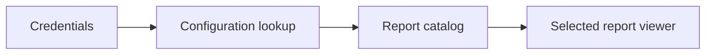

# Enterprise Indicators Portal

A React portal prototype for selecting and viewing a configured report catalog.

**React, JavaScript, Vite, Power BI integration, Netlify Functions**

## What it does

- Presents a sign-in screen and report navigation.
- Uses a server-side function to check a locally configured user list.
- Embeds reports only from operator-supplied configuration; the public catalog is empty.

## Workflow



## Local setup and use

```powershell
npm ci
npm run dev
```
Use a maintained Node.js LTS release. `npm run build` produces the local production build; it does not publish it.
The Vite server alone does not emulate Netlify Functions. For the full local prototype use Netlify CLI development mode. Copy `portal-config.example.json` to ignored `portal-config.local.json` and set `PORTAL_CONFIG_PATH` to its absolute path for the local function.

## Boundaries and limitations

Authentication is a prototype: plaintext credential comparison, no durable trusted session and no per-user authorization boundary. Do not use it to protect sensitive reports. No internal report URL or user list is included. This is distinct from the Next.js/Supabase `fpa-reports` project.

This is a source snapshot, not a claim of production readiness. Business results, dates and unmeasured performance are intentionally not asserted. Application UI language is preserved.

## License

No new distribution license is granted for this corporate source edition. Public visibility does not grant reuse rights; obtain permission from the relevant rights holder. Existing third-party notices remain applicable.

## Verification record

See [snapshot checks and remaining limitations](docs/VERIFICATION.md).
